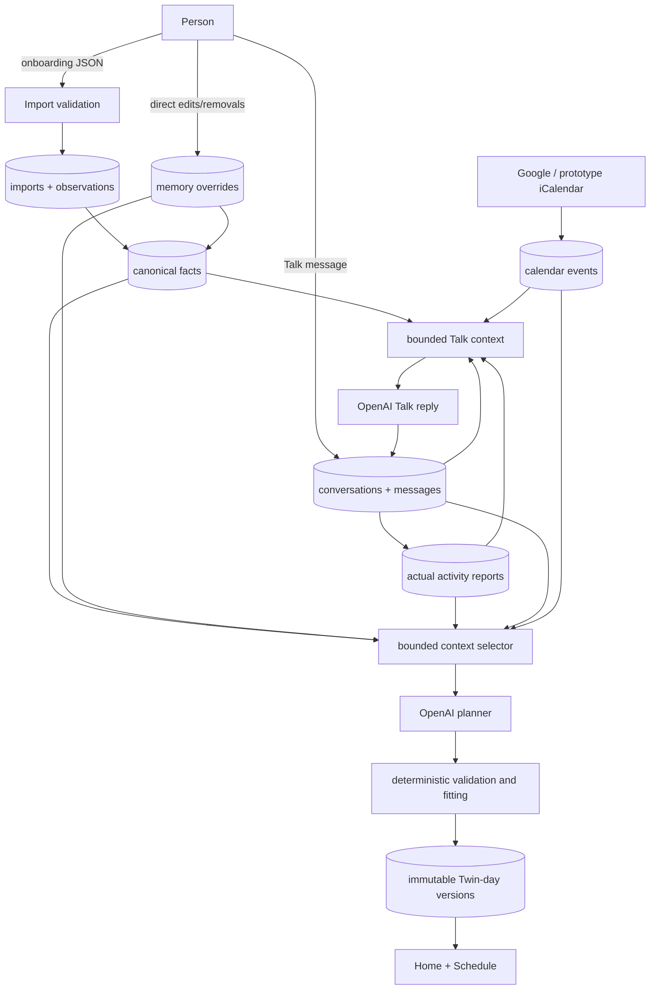

# Personal Twin project map

This is the companion reference to [README.md](README.md). The README explains how to run and use Personal Twin; this document explains where files belong, what each maintained file does, and how information moves through the system.

## The shortest useful map

```text
Browser UI (public/)
        ↓ HTTP /api/*
API boundary (src/api/router.ts)
        ↓ validated owner-scoped operations
Domain + services (src/domain/ and src/services/)
        ↓ transactions / bounded reads
PostgreSQL adapter (src/storage/)
        ↓
PostgreSQL twin schema

Server (src/server.ts) ──starts──→ Worker (src/worker.ts)
                                      ↓
                         OpenAI / Google integrations
                                      ↓
                         validated results back to PostgreSQL
```

The only private image bytes stored as ordinary files are under `data/assets/`. Personal facts, conversations, reports, Calendar records, jobs, and generated schedule metadata live in PostgreSQL.

## Root files

| File                | Purpose                                                                                                                  |
| ------------------- | ------------------------------------------------------------------------------------------------------------------------ |
| `README.md`         | Runtime setup, behavior, integrations, trust boundaries, and API examples. Start here.                                   |
| `PROJECT_MAP.md`    | This file: repository map and end-to-end information flow.                                                               |
| `AGENTS.md`         | Canonical instructions for coding agents working in this repository.                                                     |
| `PLANS.md`          | Required structure and workflow for durable implementation plans.                                                        |
| `code_review.md`    | Correctness, trust, security, and verification checklist.                                                                |
| `package.json`      | Node requirements, dependencies, and commands such as `dev`, `test`, and `verify`.                                       |
| `package-lock.json` | Reproducible exact dependency versions; generated by npm.                                                                |
| `tsconfig.json`     | TypeScript type-checking configuration.                                                                                  |
| `eslint.config.js`  | JavaScript/TypeScript linting configuration and ignored generated/reference paths.                                       |
| `.editorconfig`     | Basic editor formatting defaults.                                                                                        |
| `.prettierrc.json`  | Prettier formatting rules.                                                                                               |
| `.prettierignore`   | Paths intentionally excluded from formatting.                                                                            |
| `.node-version`     | Expected local Node.js version.                                                                                          |
| `.gitignore`        | Private, generated, and machine-local files excluded from Git.                                                           |
| `.env.example`      | Safe example of required environment-variable names. Contains no live credentials.                                       |
| `.env`              | Ignored machine-local database address, encryption key, and provider configuration. Never publish or casually rename it. |

## Runtime source

### Server entry points

| File            | Purpose                                                                                                      |
| --------------- | ------------------------------------------------------------------------------------------------------------ |
| `src/server.ts` | Starts the HTTP server, initializes PostgreSQL, serves browser assets, and starts the one in-process worker. |
| `src/worker.ts` | Claims asynchronous jobs for planning, sync, avatar generation, retries, and cleanup.                        |
| `src/dev.ts`    | Local development entry point and developer startup behavior.                                                |

### API

| File                | Purpose                                                                                                    |
| ------------------- | ---------------------------------------------------------------------------------------------------------- |
| `src/api/router.ts` | Validates HTTP requests, enforces owner scoping, exposes safe DTOs, and coordinates transactions/services. |

### Domain rules

| File                    | Purpose                                                                                               |
| ----------------------- | ----------------------------------------------------------------------------------------------------- |
| `src/domain/types.ts`   | Shared record and API types for memory, schedules, conversations, integrations, avatars, and jobs.    |
| `src/domain/imports.ts` | Validates onboarding handoffs and applies observations, facts, precedence, and tombstones atomically. |
| `src/domain/planner.ts` | Deterministic schedule validation, fitting, preservation, and demo-plan behavior.                     |
| `src/domain/time.ts`    | Time-zone, local-date, DST, interval, and overlap utilities.                                          |

### Services

| File                                  | Purpose                                                                            |
| ------------------------------------- | ---------------------------------------------------------------------------------- |
| `src/services/day-planning.ts`        | Shared orchestration for morning, conversation-triggered, and manual AI planning.  |
| `src/services/prototype-calendar.ts`  | Applies the shared prototype Calendar source through the normal Calendar contract. |
| `src/services/avatar-cancellation.ts` | Connects Stop actions to active avatar-request abort controllers.                  |

### Integrations

| File                                     | Purpose                                                                                   |
| ---------------------------------------- | ----------------------------------------------------------------------------------------- |
| `src/integrations/openai.ts`             | Server-only OpenAI text/planner calls, contracts, validation, and provider-error mapping. |
| `src/integrations/openai-realtime.ts`    | Bounded voice context, Realtime prompt/config, and server-brokered WebRTC provider call.  |
| `src/integrations/google.ts`             | Google OAuth, Calendar/Gmail discovery and sync requests, pagination, and errors.         |
| `src/integrations/prototype-calendar.ts` | Fetches and parses the prototype iCalendar feed.                                          |
| `src/integrations/calendar-event.ts`     | Normalizes provider Calendar data into Twin's Calendar-event contract.                    |
| `src/integrations/provider-json.ts`      | Safely narrows untrusted provider JSON values.                                            |
| `src/integrations/secrets.ts`            | Encrypts and decrypts server-side provider credentials.                                   |

### Storage

| File                                  | Purpose                                                                                      |
| ------------------------------------- | -------------------------------------------------------------------------------------------- |
| `src/storage/postgres.ts`             | PostgreSQL pool, state reads, scoped context reads, validation, and row-level change writes. |
| `src/storage/store.ts`                | Store interface, local profile initialization, and demo fixture construction.                |
| `src/storage/context.ts`              | Selects bounded, owner-scoped context for Talk and AI planning.                              |
| `src/storage/migrate.ts`              | Runs the tracked SQL migration safely under a database advisory lock.                        |
| `src/storage/import-json.ts`          | One-time importer for the legacy `data/twin.json` backup.                                    |
| `src/storage/import-calendar-feed.ts` | Manual command for refreshing the shared prototype Calendar feed.                            |
| `src/storage/seed.ts`                 | Explicitly creates demo data in a brand-new empty installation.                              |

### Configuration source

| File                               | Purpose                                                                                          |
| ---------------------------------- | ------------------------------------------------------------------------------------------------ |
| `src/config/prototype-calendar.ts` | Reads and validates the ignored local prototype Calendar configuration without exposing its URL. |

## Browser interface

| File                           | Purpose                                                                             |
| ------------------------------ | ----------------------------------------------------------------------------------- |
| `public/index.html`            | Browser entry document and stylesheet/script loading order.                         |
| `public/app.js`                | Home, Schedule, Settings, onboarding, Talk, browser state, and API interactions.    |
| `public/talk-voice.js`         | Native WebRTC lifecycle, completed transcripts, mute/end/retry, and audio analysis. |
| `public/styles.css`            | Shared legacy/global component styles.                                              |
| `public/home.css`              | Home and Schedule visual layout.                                                    |
| `public/mockup-pages.css`      | Current Settings, Schedule, Talk, and responsive product-surface styling.           |
| `public/avatar.css`            | Avatar artwork and scene presentation styles.                                       |
| `public/onboarding.css`        | Pre-app onboarding layout and responsive behavior.                                  |
| `public/onboarding-prompt.txt` | Copyable ChatGPT onboarding prompt shown to the user.                               |

The browser never calls OpenAI or Google directly and never receives raw API keys, refresh tokens, encrypted credential blobs, or private filesystem paths.

## Database and private runtime data

| Path                                   | Purpose                                                                                                                                 |
| -------------------------------------- | --------------------------------------------------------------------------------------------------------------------------------------- |
| `db/README.md`                         | PostgreSQL setup, migration, import, backup, testing, and safety instructions.                                                          |
| `db/schema.sql`                        | Convenience SQL entry point that includes the tracked migration.                                                                        |
| `db/migrations/001_records.sql`        | Creates the `twin` schema, record tables, owner constraints, and indexes. This defines structure; it is not the live database contents. |
| `db/migrations/002_voice_sessions.sql` | Adds owner-scoped durable voice-session lifecycle records.                                                                              |
| `data/twin.json`                       | Legacy ignored import/backup source. The running app no longer reads or writes it.                                                      |
| `data/assets/`                         | Private uploaded and generated avatar image bytes. Metadata remains in PostgreSQL.                                                      |
| `data/style-references/`               | Server-only avatar style reference images used during generation.                                                                       |

If PostgreSQL runs in Docker, its live database files are managed by Docker's named volume rather than appearing as a `.sql` file in this repository.

## Local configuration

| File                                     | Purpose                                                                      |
| ---------------------------------------- | ---------------------------------------------------------------------------- |
| `config/prototype-calendar.example.json` | Safe template describing the prototype Calendar configuration shape.         |
| `config/prototype-calendar.local.json`   | Ignored private machine-local Calendar feed configuration. Never publish it. |

## Tests

| File                              | Purpose                                                                                           |
| --------------------------------- | ------------------------------------------------------------------------------------------------- |
| `test/memory-store.ts`            | In-memory Store test double used by fast tests.                                                   |
| `test/domain.test.ts`             | Import, memory precedence, time, and deterministic domain behavior.                               |
| `test/context.test.ts`            | Talk/planning context selection, bounds, source separation, and owner scoping.                    |
| `test/planning.test.ts`           | AI planning orchestration, validation, retries, protected history, Calendar, and revisions.       |
| `test/router.test.ts`             | HTTP contracts, ownership, imports, Settings, Talk, Calendar, avatars, and deletion behavior.     |
| `test/realtime-voice.test.ts`     | Realtime configuration, bounded context, SDP broker, finalization, and audio helpers.             |
| `test/postgres.test.ts`           | Opt-in disposable PostgreSQL migration/import/transaction integration suite.                      |
| `test/calendar.test.ts`           | Calendar normalization and date/time behavior.                                                    |
| `test/google.test.ts`             | Google Calendar/Gmail pagination, credentials, reconnect, and stale-sync protection.              |
| `test/prototype-calendar.test.ts` | Shared iCalendar configuration, importing, windowing, and owner isolation.                        |
| `test/avatar-worker.test.ts`      | Avatar prompt/reference order, transparency, cancellation, output, and provider failure behavior. |
| `test/ui.test.ts`                 | Maintained browser source and key UI contract assertions.                                         |

## Documentation

| Path                          | Purpose                                                                                    |
| ----------------------------- | ------------------------------------------------------------------------------------------ |
| `docs/product-direction.md`   | Long-form product direction and acceptance criteria formerly named `twin plan 2.md`.       |
| `docs/plans/`                 | Durable implementation plans, decisions, discoveries, progress, and observed verification. |
| `docs/references/ui/`         | Standalone visual/interaction mockups. Reference only; not runtime behavior.               |
| `docs/references/onboarding/` | Original onboarding prompt and preview references. Reference only.                         |
| `docs/screenshots/`           | Development screenshots used for visual comparison. Not runtime assets.                    |

### Plans currently in `docs/plans/`

| Plan                                     | Scope                                                                         |
| ---------------------------------------- | ----------------------------------------------------------------------------- |
| `adaptive-memory-planning.md`            | Expanded adaptive memory and planning direction.                              |
| `organized-adaptive-memory.md`           | Proposed clean evidence/profile/recent-context architecture.                  |
| `agent-orchestration.md`                 | Main-agent and bounded subagent workflow.                                     |
| `ai-day-planning-agent.md`               | AI day-planning service and trust boundaries.                                 |
| `allow-multiple-experiments.md`          | Support for several optional habit experiments.                               |
| `avatar-style-reference.md`              | Server-side avatar style reference behavior.                                  |
| `avatar-version-carousel.md`             | Avatar version selector, deletion, cancellation, and transparent output work. |
| `canonical-calendar-commitment-times.md` | Exact Calendar commitment time handling.                                      |
| `catch-up-plausible-history-repair.md`   | Safe catch-up history repair.                                                 |
| `frontend-polish.md`                     | Product UI refinement.                                                        |
| `google-calendar-live.md`                | Live Google Calendar integration.                                             |
| `initial-day-backlog.md`                 | Initial current-day coverage and backlog behavior.                            |
| `manual-rebuild-catch-up.md`             | Manual actual-report catch-up flow.                                           |
| `onboarding-first-four.md`               | First onboarding screens and reference alignment.                             |
| `onboarding-openai-day-plan.md`          | OpenAI connection and first-day generation during onboarding.                 |
| `repair-flexible-schedule-output.md`     | Safe fitting of flexible generated activities.                                |
| `repository-organization.md`             | This repository cleanup and recovery plan.                                    |
| `schedule-ui-cleanup.md`                 | Cleaner Schedule presentation.                                                |
| `single-active-day-version.md`           | One visible active immutable day version.                                     |
| `trigger-specific-planning-context.md`   | Context separation by planning trigger.                                       |
| `workflow-foundation.md`                 | Repository guidance, plans, verification, and CI foundation.                  |

## Development and agent tooling

| Path                                  | Purpose                                                                      |
| ------------------------------------- | ---------------------------------------------------------------------------- |
| `.agents/skills/twin-plan/SKILL.md`   | Repository-specific planning workflow.                                       |
| `.agents/skills/twin-verify/SKILL.md` | Repository-specific verification and handoff workflow.                       |
| `.codex/config.toml`                  | Local Codex project configuration.                                           |
| `.codex/agents/`                      | Repository custom-agent definitions.                                         |
| `.github/workflows/ci.yml`            | GitHub verification workflow.                                                |
| `.git/`                               | Git history and repository metadata. Never manually reorganize its contents. |
| `node_modules/`                       | Installed generated dependencies. Recreated with `npm ci`; never hand-edit.  |

## Information flow



### Memory precedence

```text
Direct user edit or removal
            ↓ outranks
Explicit user statement in Talk
            ↓ outranks
Explicit onboarding statement
            ↓ outranks
Model inference / possible Gmail cue

Removal tombstone ──prevents──→ repeat import or inference restoring the fact
```

### Avatar flow

```text
Private source photo (data/assets/)
        ↓ explicit Generate request
Server worker + OpenAI image edit
        ↓ transparent PNG result
Private generated asset (data/assets/)
        ↓ metadata + selection
PostgreSQL avatar records
        ↓ authorized /api/assets/:id stream
Home and Avatar Studio
```

### Calendar flow

```text
Google OAuth OR private prototype iCalendar configuration
        ↓ server-only adapter
Normalized owner-scoped Calendar events
        ↓ bounded target-day selection
Planner context as real commitments
        ↓
Generated schedule keeps Calendar meaning distinct from imagined activity
```

## What may be reorganized safely

- Documentation, plans, screenshots, and reference mockups may move when every repository reference is updated.
- Runtime source paths, SQL migrations, private data, `.env`, package files, and generated asset paths should remain stable unless a dedicated migration plan proves compatibility.
- Never manually edit PostgreSQL's internal data directory. Use migrations, application APIs, account export, and documented backup tools.
